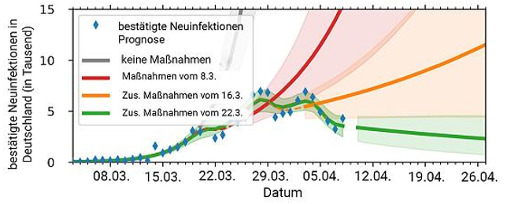
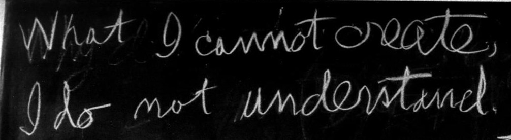
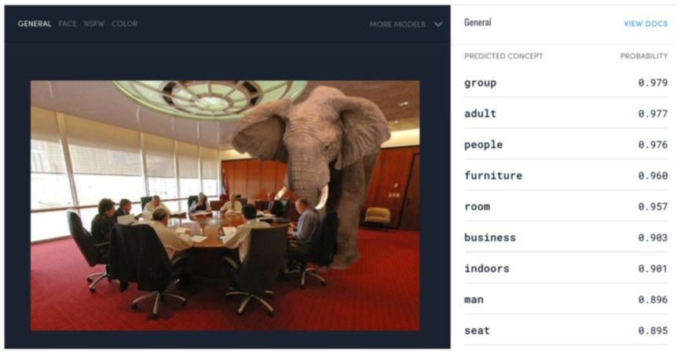
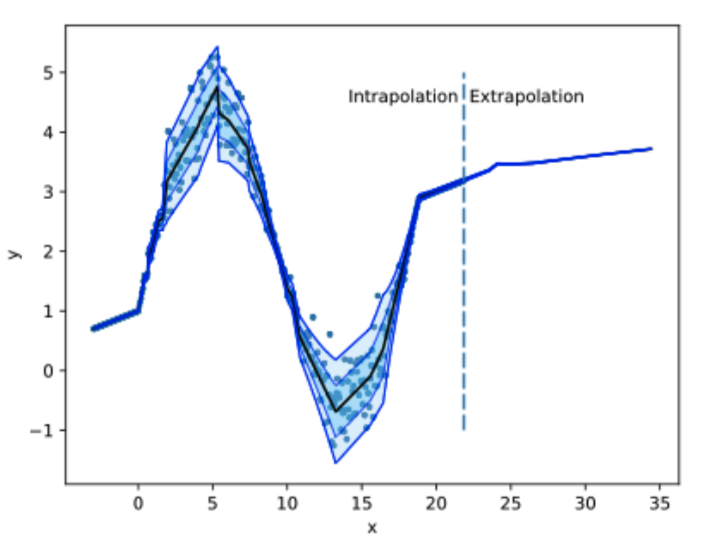
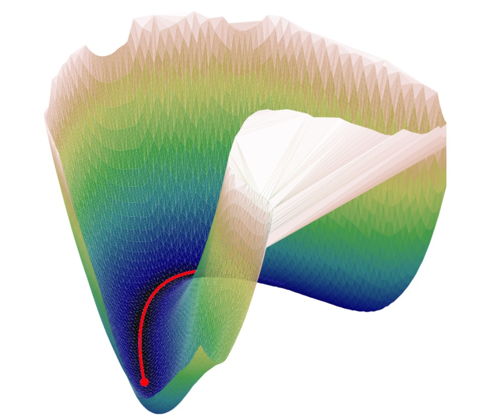
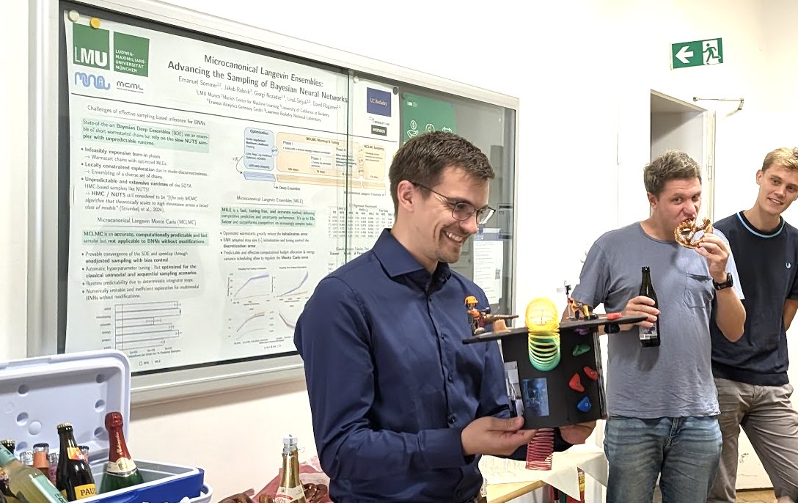

# Bayesian Statistics

**Running the model backwards**

<br>

Oliver Dürr — TIDIT Retreat (24 Sep 2026)

<!--
Two parts. First 30 minutes: one example, start to finish, most of it live.
Last 10: what happens when the model is a neural network — which is the
research part.
-->

---

# Two directions

<svg viewBox="0 0 800 300" class="w-full max-w-3xl mx-auto mt-2">
  <defs>
    <marker id="arrF" viewBox="0 0 10 10" refX="8" refY="5" markerWidth="7" markerHeight="7" orient="auto">
      <path d="M 0 0 L 10 5 L 0 10 z" style="fill:#2d5986" />
    </marker>
    <marker id="arrB" viewBox="0 0 10 10" refX="8" refY="5" markerWidth="7" markerHeight="7" orient="auto">
      <path d="M 0 0 L 10 5 L 0 10 z" style="fill:#c0392b" />
    </marker>
  </defs>
  <ellipse cx="150" cy="150" rx="115" ry="50" style="fill:#eef3f8;stroke:#2d5986;stroke-width:2" />
  <text x="150" y="158" style="text-anchor:middle;font-size:26px;font-weight:600;fill:#1a3a5c">Model</text>
  <ellipse cx="650" cy="150" rx="115" ry="50" style="fill:#eef3f8;stroke:#2d5986;stroke-width:2" />
  <text x="650" y="158" style="text-anchor:middle;font-size:26px;font-weight:600;fill:#1a3a5c">Data</text>

  <path d="M 235 108 Q 400 15 565 108" style="fill:none;stroke:#2d5986;stroke-width:3" marker-end="url(#arrF)" />
  <text x="400" y="22" style="text-anchor:middle;font-size:18px;fill:#2d5986;font-weight:600">probability theory</text>
  <text x="400" y="44" style="text-anchor:middle;font-size:15px;fill:#2d5986">the forward pass — simulate data from parameters</text>

  <path d="M 565 192 Q 400 285 235 192" style="fill:none;stroke:#c0392b;stroke-width:3" marker-end="url(#arrB)" />
  <text x="400" y="266" style="text-anchor:middle;font-size:18px;fill:#c0392b;font-weight:600">statistics</text>
  <text x="400" y="288" style="text-anchor:middle;font-size:15px;fill:#c0392b">the backward pass — infer parameters from data</text>
</svg>

<div v-click class="mt-4 text-center">
Plan for today: 
1. Tell data generating story (forward pass in plain numpy) 
2. Use the computer to run it backwards.
</div>

<!--
Everything in this talk is this picture. 

Forward is easy: You generate data. People call this the "tell the data generating story". You use tools from probability theory to model your uncertainty

Backward is what statistics is. The Bayesian claim is that
the backward pass should be *the same program*, run in the other direction.
-->

---

# One example, all the way through

**33 North American women.** Two numbers each: age and systolic blood pressure. We will **not look at the blood pressures yet**.

<div class="mt-3 mb-4 px-4 py-2 bg-amber-50 rounded [&>p]:my-0">

**The Bayesian tool:** probability = **degree of belief**¹. Anything we are unsure about can get a probability: the slope, a hypothesis, the probability that Trump takes a third term.

</div>

<v-clicks>

- Before looking at the data, what do we believe?
  - blood pressure rises **linearly** with age (our assumption) — but how fast? <span class="guess">Any idea?</span>
  - a newborn already has *some* blood pressure. <span class="guess">Any idea?</span>
  - not everyone of the same age has the same pressure. <span class="guess">How much ±? Any idea?</span>
- Then: write down how a random woman of a given age gets her blood pressure

</v-clicks>

<div v-click class="mt-3 px-3 py-2 border-l-4 border-blue-700 bg-blue-50 text-sm">

→ <a href="https://github.com/oduerr/talks/blob/main/src/slidev/2026_bayes_tidit/bayes_workflow.ipynb" target="_blank" class="font-bold">notebook</a> &nbsp; 1. the story, in numpy &nbsp;·&nbsp; 2. run it 200 times &nbsp;·&nbsp; 3. look at the data &nbsp;·&nbsp; 4. run it backwards

</div>

<div class="footnotes">

¹ Coherent degrees of belief satisfy Kolmogorov's axioms: probabilities in the full mathematical sense (Cox).

</div>

<!--
Ask the room for numbers here: how much does blood pressure rise per year?
Whatever they say goes into the notebook. Then switch.

The point of not showing the scatter plot: the workflow says you write down
your beliefs before you look. Make them experience that, do not just say it.

The amber box is the licence for everything that follows. Without it, "what
do we believe about the slope?" is not a statistical question. A frequency
probability needs repetitions. A degree of belief needs neither repetitions
nor a "true value" behind it: there is no true probability that Trump takes
a third term, only what each of us believes given what we know.
It comes back on the credible-interval slide: "the slope is in here with 95%
probability" is a statement about our belief, which this box allows.

Footnote fine print, if a statistician asks: Cox and the Dutch-book argument
give finite additivity. Countable additivity, as in Kolmogorov, is the usual
extra assumption.
-->

---

# Why numpy cannot run backwards (technical detail)

<div class="text-sm">

| forward only | both directions |
|---|---|
| <code>a = np.random.normal(<span class="guess">1, 0.4</span>)</code> | <code>a = numpyro.sample("a", dist.Normal(<span class="guess">1, 0.4</span>))</code> |
| <code>b = np.random.normal(<span class="guess">100, 15</span>)</code> | <code>b = numpyro.sample("b", dist.Normal(<span class="guess">100, 15</span>))</code> |
| <code>sigma = abs(np.random.normal(0, <span class="guess">20</span>))</code> | <code>sigma = numpyro.sample("sigma", dist.HalfNormal(<span class="guess">20</span>))</code> |
| `sbp = np.random.normal(b + a*age, sigma)` | `numpyro.sample("sbp", dist.Normal(b + a*age, sigma), obs=sbp)` |

</div>

- Numpy just stores the draw number not where it came from. So it cannot run backwards.

- **`obs=` is the switch.** Same function: `sbp=None` runs forward, `sbp=data` runs backward.

<div class="text-xs opacity-60 mt-2"><span class="guess">orange</span> = the numbers the room guessed on the previous slide</div>

---

# Same problem, the classical way

<div class="grid grid-cols-2 gap-4">

<div>

```python
import statsmodels.api as sm
fit = sm.OLS(sbp, sm.add_constant(age)).fit()
print(fit.summary())
```

```txt
              coef  std err    t   P>|t|   [0.025  0.975]
const       87.671   10.076 8.701  0.000    67.120 108.223
age          1.105    0.206 5.364  0.000     0.685   1.525
```

</div>

<div>

```r
fit <- lm(sbp ~ age)
summary(fit)
```

```txt
            Estimate Std.Error t value Pr(>|t|)
(Intercept)   87.671    10.076   8.701  7.97e-10
age            1.105     0.206   5.364  7.56e-06

Residual standard error: 19.28,  R² 0.481
```

</div>

</div>

<div class="text-xs opacity-50 mt-1">Same fit, same numbers — Python and R agree to three decimals.</div>

<v-click>

| | slope | 95% interval |
|---|---|---|
| **Bayes** — what we just did | 1.02 | \[0.69, 1.37\] |
| **least squares** | 1.11 | \[0.69, 1.53\] |

</v-click>

<v-click>

Same answer in principle. 

Fineprint:
The Bayesian (credible) interval is ~19% narrower compared to the classical (frequentist) interval. This is because we put in a prior. With a flat prior it becomes \[0.69, 1.52\]  the classical interval, recovered.

</v-click>

<!--
Do not oversell the narrower interval. Information in, information out. The
honest point is: with weak priors Bayes reproduces the classical result, with
real prior knowledge it uses it, and either way you can see what you assumed.
-->

---

# The role of the prior

<div class="grid grid-cols-[1fr_1fr] gap-8 mt-10 items-center">

<div class="[&_li]:leading-snug">

<div v-click="1" class="mb-4">

- **Little data, real knowledge: put it in.** Covid, early 2020: few data points, but for an airborne disease we know $t_0$ is a few days (not hours or months).

</div>

<div v-click="2" class="mb-4">

- **Much data: the prior washes out.** Bayes reproduces the classical result (if you don't shoot yourself in the foot)¹.

</div>

<div v-click="3">

- **A spectrum, not a switch.** Informative → weakly informative → "non-informative" (Jeffreys, reference priors).

</div>

</div>

<div v-click="1">



<div class="text-xs opacity-60 mt-1">Change-point model: <a href="https://arxiv.org/abs/2004.01105" target="_blank">Dehning, Priesemann et al., Science 2020</a></div>

</div>

</div>

<div v-click="4" class="mt-10 text-center">

**Domain knowledge in the prior is a bonus. A weak prior costs you nothing.**

</div>

<div class="footnotes">

¹ For regular models with a fixed number of parameters (Bernstein–von Mises), and only if the prior gives the truth some mass.

</div>

<!--
The corona example: serial interval, incubation time and doubling time were
all put in as priors in the early models, because the case data alone could
not identify them. That is prior knowledge doing real work.
The chart is the Göttingen model (Dehning, Priesemann et al., Science 2020):
an SIR model with change points, fitted in PyMC3. Priors on the spreading
rate, the recovery rate, the reporting delay, and on when each intervention
took effect. With a few weeks of noisy counts, the priors are what made the
three scenarios (8, 16, 22 March) distinguishable at all.
The last line is the message: a prior is not optional, but domain knowledge
in it is. With a weak prior you get the classical answer back.
-->

---

# When classical, when Bayesian?

<div class="grid grid-cols-2 gap-8 mt-2">

<div>

**Classical Statistics**

- you pick a standard model that (roughly) fits your data
    - linear regression, GLMs, logistic regression (if the classes overlap³)
- fast, well understood, no computational issues, standard errors for free¹
- it scales to neural networks as maximum likelihood, but the uncertainty recipe does not²

</div>

<div v-click>

**Bayesian Statistics**

- you define the model (the DGP) yourself. Novel complex models are possible
    - hierarchical, nonlinear, ODEs, latent variables
    - logistic regression always, with a proper prior³
- little data and real prior knowledge
- you need uncertainty, for the parameters or anything derived from them

</div>

</div>

<div class="footnotes">

¹ Asymptotic (Wald) intervals from the Fisher information. Approximate for small samples.<br>
² The curvature of the likelihood at the optimum is meaningless for an over-parametrised net. Workarounds exist (deep ensembles, conformal prediction). Part 2.<br>
³ Separation: if a predictor splits 0s and 1s perfectly, the logistic MLE does not exist. Any proper prior fixes it; the classical fix (Firth) is the Jeffreys prior.

</div>

<!--
Both groups are in the room, so be fair to both.

To the PAIR side: on their home turf, a GLM on a few hundred rows, classical
is hard to beat. No sampler, no convergence diagnostics, standard errors for
free. Footnote 1 is the fine print: those errors are asymptotic.

To the DS side: deep learning IS classical statistics. It is maximum
likelihood, and it scales beautifully. What does not scale is the uncertainty
recipe, the curvature at the optimum. Footnote 2 pre-empts "but ensembles,
but conformal": yes, they exist, they are not parameter-level uncertainty.
That gap is Part 2.

The Bayesian pitch is not better numbers. Slide 5 showed the same numbers.
The pitch is: you write the data-generating process yourself, whatever it
is, and inference comes for free. Then any quantity you can compute from the
parameters has a posterior. P(a > 0 | data) was one line. Hierarchical
models are the everyday case where this pays off.

Little data and real prior knowledge is the corona example from the previous
slide. Do not repeat it, just point back.

Footnote 3, if asked, the demo (10 points, all 0 below x = 5.5, all 1 above):
R glm: slope 44.7, SE 61,172, p = 0.999, "did not converge". The strongest
possible effect reported as not significant. NumPyro with N(0, 2.5) priors on
standardised x: slope 3.9, 95% [1.3, 7.4], P(slope > 0) = 0.9995. Honest
caveat: here the prior does not wash out, the upper end comes from the prior
scale. With a flat prior the Bayesian posterior is improper too.
-->

---

# Bayes in practice

<div class="grid grid-cols-2 gap-8 mt-2">

<div>

**Where it hurts**

- sampling can be hard: babysit chains, reparametrisation tricks and other know-how → AutoStan
- cost: cheap (2026 on a Mac 😉) at problems where you can define the DGP; unfeasible for Neural Network Size Models (see later)

</div>

<div v-click>

**Where it fits**

- scientists think generatively anyway: say how the data came about, then run it backwards (for free)
- StanCon 2026: anthropology, psychology, economics, music theory, …

</div>

</div>

<div v-click class="mt-6 flex flex-col items-center">

<div class="text-xs opacity-60 mt-1">Feynman's blackboard at his death, 1988. Courtesy of the Archives, California Institute of Technology.</div>

</div>

<!--
The cost bullet is the honest bridge to Part 2: for this model the posterior
takes a second; for a network it is the whole research problem.
The blackboard is the punchline of Part 1: if you can write down how the
data are created, you understand the problem, and the Bayesian machinery
runs that creation backwards for free. The quote was in the top-left corner
of Feynman's Caltech blackboard when he died in February 1988.
-->

---
layout: center
class: text-center
---

# Part 2

## Bayesian neural networks — making the backward pass tractable

---

# The elephant in the room

<div class="grid grid-cols-[2fr_3fr] gap-8 mt-12 items-center">

<div>

- Standard deep learning is trained by **maximum likelihood**
- i.e. classical statistical training, but **without confidence intervals**
- No elephant in the prediction, and no sign of doubt either

</div>

<div>



<div class="text-xs opacity-60 mt-2">The image is too far away from the training data. Rosenfeld et al., <i>The Elephant in the Room</i>, NeurIPS 2018 Workshop on Causal Learning.</div>

</div>

</div>

---

# Aleatoric vs. epistemic uncertainty

<div class="grid grid-cols-[1fr_1fr] gap-8 mt-2 items-center">

<div class="relative">



<div class="absolute text-xs font-bold px-1 rounded" style="left:44%; top:23%; color:#1d4ed8">← much spread in the data:<br>aleatoric</div>
<div class="absolute text-xs font-bold px-1 rounded" style="left:70%; top:50%; color:#c0392b">↑ no epistemic<br>uncertainty<br>in standard DL</div>

</div>

<div>

- **Aleatoric**: noise in the data. It stays, even for $N \to \infty$. From *alea*, the die.
- **Epistemic**: the uncertainty when leaving known ground. It shrinks with more data.
- Standard deep learning models the first, but not the second.

</div>

</div>

<div class="mt-6 p-3 bg-blue-50 rounded text-center">

Epistemic uncertainty = the uncertainty about the **weights** (parameter uncertainty). That is exactly what the Bayesian recipe provides.

</div>

---

# Getting epistemic uncertainty in deep learning

<div class="grid grid-cols-[1fr_2fr] gap-10 mt-10 items-center">

<div class="flex flex-col gap-6 text-center">

<div>
<div class="text-5xl font-bold" style="color:#2d5986">&lt; 100</div>
<div class="text-sm opacity-70">parameters in traditional statistics</div>
</div>

<div>
<div class="text-5xl font-bold" style="color:#c0392b">10⁶ +</div>
<div class="text-sm opacity-70">parameters where deep learning starts</div>
</div>

</div>

<div>

- **Classical:** confidence intervals need the Hessian of the loss. At this size, no way.
- **Bayesian:** translates in principle, but
  - sampling does not work out of the box
  - the loss landscape is much rougher
- We need **approximations**: variational inference, MC dropout, deep ensembles, Laplace, SG-MCMC, …

<div class="mt-4 p-3 bg-blue-50 rounded">

One line of research: **subspace inference**.

</div>

</div>

</div>

---

# Subspace inference: the idea

<div class="grid grid-cols-[4fr_4fr_3fr] gap-x-6 gap-y-4 mt-2">

<div class="row-span-2 flex items-center">

</div>

<div>

**Observation:** the loss minima of a neural network are connected.

Instead of sampling in $\mathbb{R}^{10^6}$, construct a **low-dimensional manifold** and sample there.

</div>

<div class="text-center">

<div class="text-xs opacity-60 mt-1">Daniel's defense, 23 Sep, Munich</div>
</div>

<div class="col-span-2 text-sm">

| | | |
|---|---|---|
| AISTATS 2024 | simple subspace | <a href="https://arxiv.org/abs/2401.12950" target="_blank">arXiv:2401.12950</a> |
| AISTATS 2025 | advanced subspace | <a href="https://arxiv.org/abs/2503.03382" target="_blank">arXiv:2503.03382</a> |
| NeurIPS 2026 (submitted) | LLMs (Qwen 8B), LoRA | <a href="https://arxiv.org/abs/2605.29580" target="_blank">arXiv:2605.29580</a> |

</div>

</div>

---

# Outlook: Bayes @ HTWG

<div class="grid grid-cols-2 gap-6 mt-6">

<div class="p-4 bg-gray-50 rounded">

### Saentis
<div class="text-sm opacity-60 mb-3">DFG-funded · just started</div>

Self-driving ships, **3 PhD positions**. One in Bayesian statistics:

- Bayesian deep learning models to locate other ships
- other ships modelled the Bayesian way, to predict their course with uncertainty

</div>

<div class="p-4 bg-gray-50 rounded">

### AGILE-VLA
<div class="text-sm opacity-60 mb-3">BMFTR call, 2nd round · starts early 2027</div>

Uncertainty-aware vision-language-action models, **5 PhD positions** (3 at HTWG). One in Bayesian statistics:

- uncertainty-aware VLMs, e.g. with subspace inference
- semantic uncertainty: over the whole sequence, not a single token

</div>

</div>

<!--
AGILE-VLA: second round of the BMFTR call, we are writing the subproject
description (Teilvorhaben-Beschreibung) now.
-->

---
layout: center
class: text-center
---

# Backup

<div class="text-sm opacity-60">only if the notebook misbehaves</div>

---

# Prior predictive, live

<PriorExplorer />

<!--
BACKUP — same demo as the notebook, in the browser. Drag the sliders; the
"below zero" number is the point. "condition on the data" runs a small
Metropolis sampler with whatever priors are set.
-->
